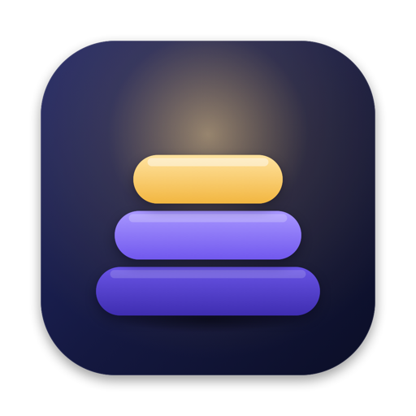
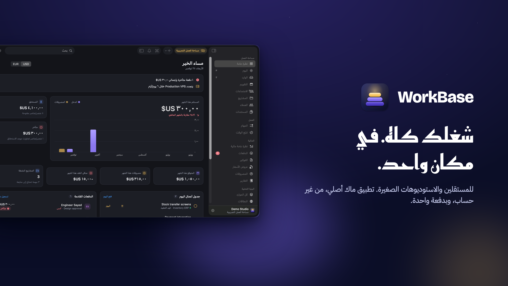
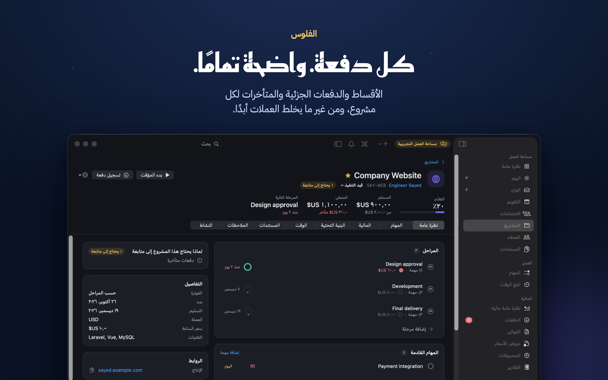
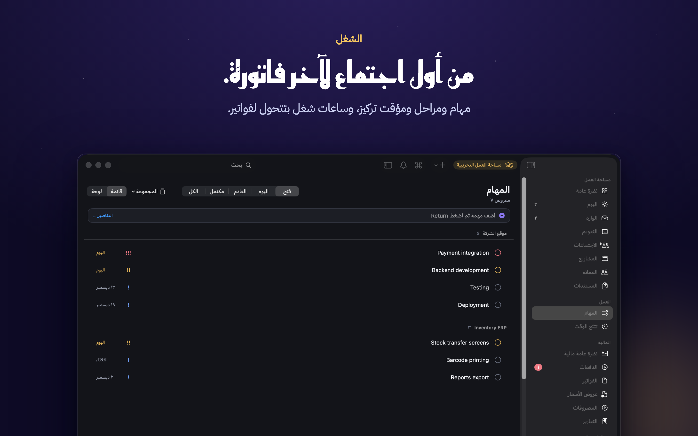
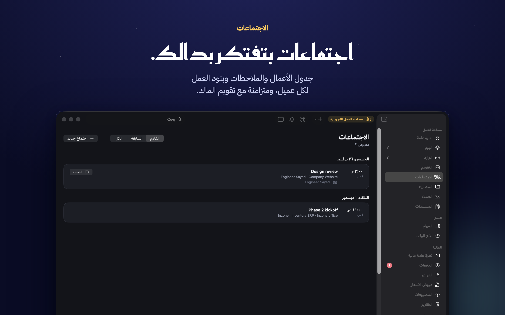
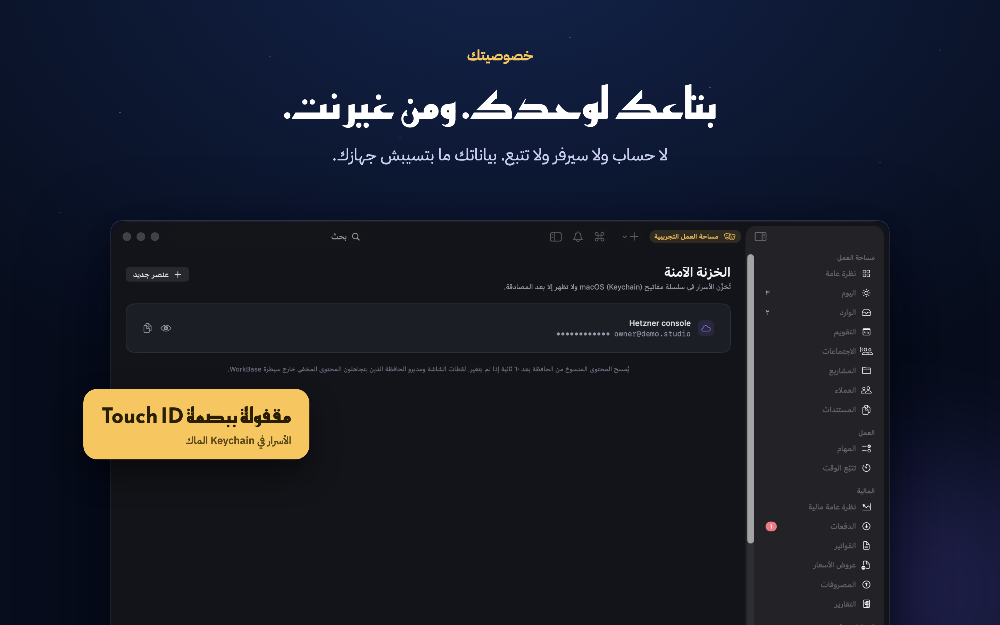

  

<h1 align="center">WorkBase</h1>

  <strong>شغلك الحر كله. في تطبيق ماك واحد.</strong> 
  المشاريع والعملاء والمدفوعات والفواتير والاجتماعات والسيرفرات. دون إنترنت، وبخصوصية كاملة، وملكك.

  <a href="README.md">English</a> ·
  <a href="https://mohamedhekal.github.io/WorkBase/">الموقع</a> ·
  <a href="https://github.com/mohamedhekal/WorkBase/issues/new/choose">الإبلاغ عن مشكلة</a> ·
  <a href="https://github.com/mohamedhekal/WorkBase/discussions">النقاشات</a> ·
  <a href="https://github.com/mohamedhekal/WorkBase/wiki">الويكي</a>

<em>قريبًا على Mac App Store. شراء مرة واحدة، بلا اشتراك.</em>

## ما هو WorkBase؟

WorkBase تطبيق ماك أصلي للمستقلين والمطورين والاستشاريين والاستوديوهات الصغيرة. يغنيك عن جداول البيانات وتطبيق الملاحظات وقالب الفواتير وقائمة كلمات المرور، ويجمع شغلك في مكان واحد هادئ. كل شيء يبقى على جهازك: بلا حساب، بلا سيرفر، بلا تتبع.

> هذا المستودع يضم صفحة WorkBase العامة والصور والدعم ومتابعة المشكلات. الكود المصدري للتطبيق غير منشور هنا.

## المميزات

### مدفوعات واضحة
- جداول دفع بالأقساط والدفعات الجزئية والمرتجعات لكل مشروع
- المستلم والمتبقي والمتأخر في لمحة واحدة
- فواتير وعروض أسعار وإشعارات دائنة بصيغة PDF أنيقة، بالعربية أو الإنجليزية
- كل مبلغ يحتفظ بعملته ولا تُجمع العملات المختلفة أبدًا. الإجماليات التقريبية «≈» اختيارية وتعتمد على أسعار صرف تدخلها أنت
- المصروفات والتكاليف المتكررة والتدفق النقدي والتقارير

### من أول اجتماع لآخر فاتورة
- مشاريع بمراحل ومهام (قائمة أو لوحة) وفحص صحة يخبرك بما يحتاج متابعة
- مؤقت تركيز وساعات عمل تتحول إلى فواتير
- شاشة «اليوم» وصندوق وارد لكل ما ينتظرك

### الاجتماعات
- جدول الأعمال والملاحظات وبنود العمل لكل اجتماع مع العميل
- انضمام بضغطة لروابط المكالمات
- مزامنة اختيارية مع تقويم «WorkBase» على الماك

### تعرّف على «طَبَق»
رفيق صغير اختياري يعيش فوق الـ Dock مع قطته. يعيش يوم عملك وفصول السنة، ويطرق الشاشة قبل الاجتماعات ويحتفل عندما تنهي مهامك. يبقى على سطح المكتب تحت نوافذك، ويطل برأسه من طرف الشاشة عندما يريد أن يقول شيئًا. تختار أنت اسمه، وهل يتكلم بصوت مسموع، ومتى يلتزم الهدوء.

### البنية التحتية والأسرار
- النطاقات والاستضافة والسيرفرات والاشتراكات مع تذكير قبل التجديد
- فحص اختياري لتوفر المواقع وشهادات SSL التي تختارها
- خزنة آمنة: الأسرار محفوظة في Keychain الماك ولا تظهر إلا ببصمة Touch ID أو كلمة المرور

### شغلك على سطح المكتب
- ١٠ ودجتس: الماليات والدفعات القادمة ومهام اليوم وتقدم المشاريع والتجديدات والمواعيد النهائية ومؤقت التركيز وغيرها
- رفيق في شريط القوائم وبحث Spotlight واختصارات Shortcuts واختصار عام للإضافة السريعة

### خصوصيتك أولًا
- بياناتك لا تغادر جهازك
- بلا حساب، بلا سيرفر، بلا تحليلات، بلا إعلانات
- نسخ احتياطي مشفّر (AES-256) وتصدير كامل في أي وقت
- اقرأ [سياسة الخصوصية](https://mohamedhekal.github.io/WorkBase/privacy.html#ar)

## المتطلبات
- macOS 14 Sonoma أو أحدث
- ماك بمعالج Apple Silicon أو Intel

## المساعدة

| | |
|---|---|
| وجدت مشكلة؟ | [افتح بلاغًا](https://github.com/mohamedhekal/WorkBase/issues/new/choose) مع خطوات تكرارها |
| عندك فكرة؟ | [اطلب ميزة](https://github.com/mohamedhekal/WorkBase/issues/new/choose) |
| سؤال أو نصيحة؟ | اسأل في [النقاشات](https://github.com/mohamedhekal/WorkBase/discussions) |
| أدلة الاستخدام | [الويكي](https://github.com/mohamedhekal/WorkBase/wiki) و[صفحة الدعم](https://mohamedhekal.github.io/WorkBase/support.html#ar) |
| أمور خاصة | البريد: mohamed.kh.hamad@icloud.com |

من فضلك لا تنشر كلمات مرور أو محتوى الخزنة أو بيانات عملاء أو مبالغ في بلاغ عام. للمشكلات الأمنية راجع [SECURITY.md](SECURITY.md).

---

© 2026 WorkBase. جميع الحقوق محفوظة.

