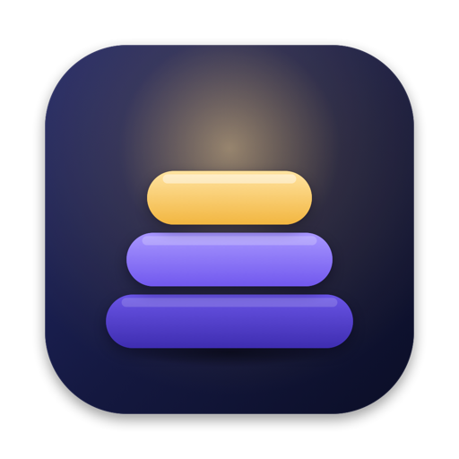
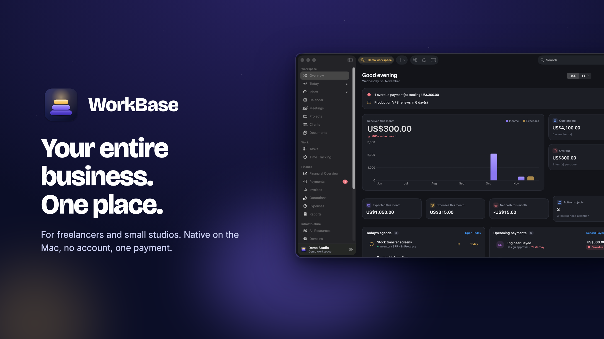
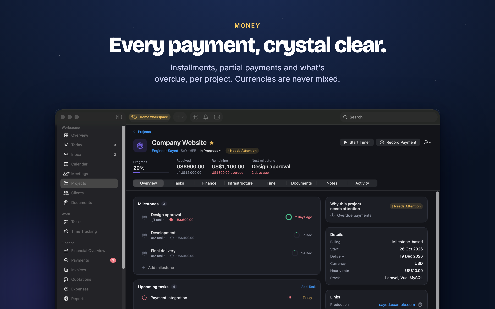
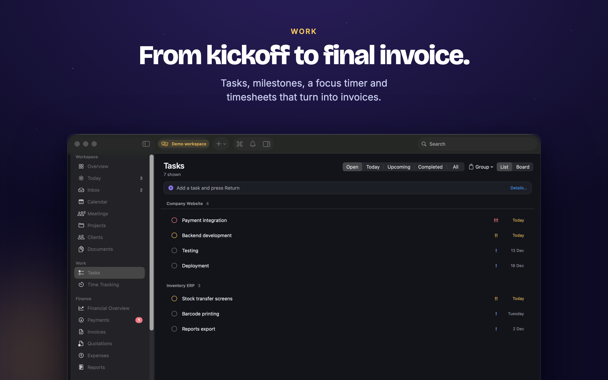
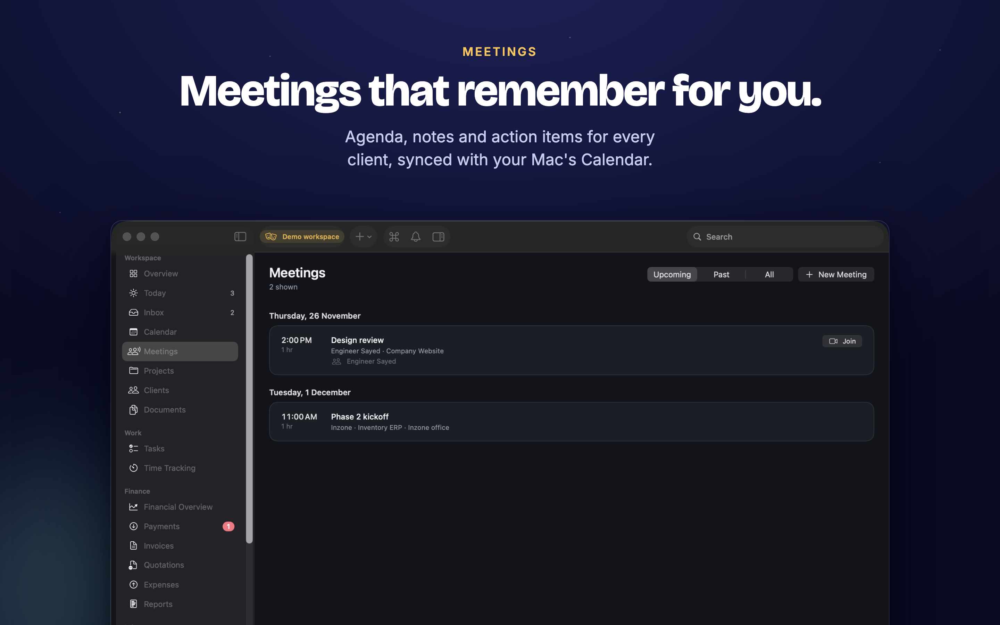
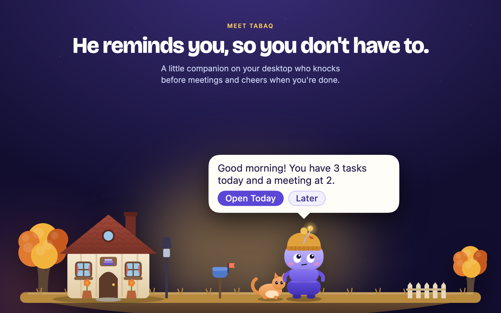
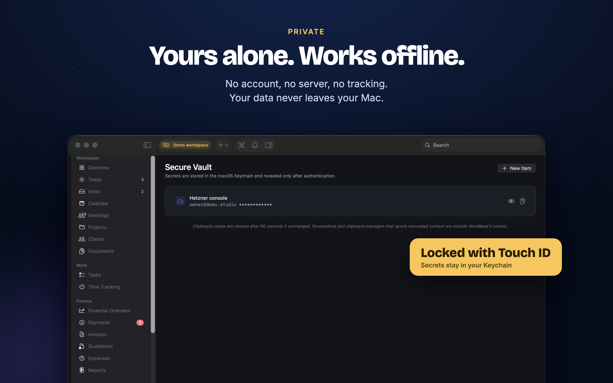
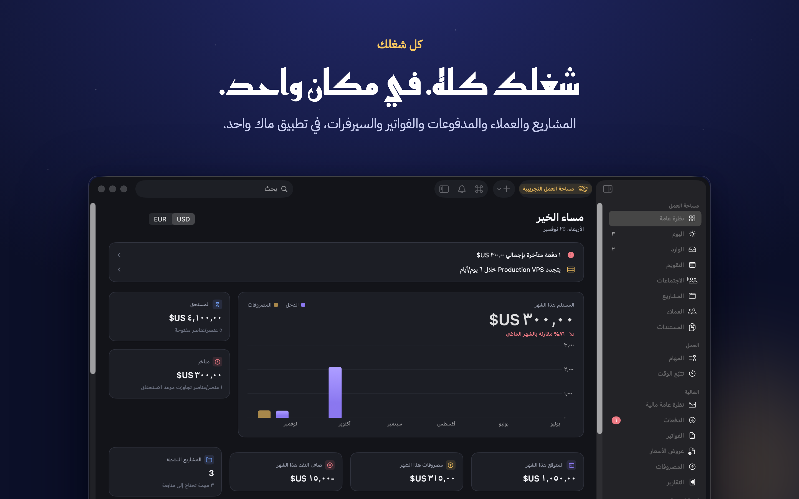

  

<h1 align="center">WorkBase</h1>

  <strong>Your entire freelance business. One native Mac app.</strong> 
  Projects, clients, payments, invoices, meetings and servers. Offline, private, yours.

  <a href="README.ar.md">العربية</a> ·
  <a href="https://mohamedhekal.github.io/WorkBase/">Website</a> ·
  <a href="https://github.com/mohamedhekal/WorkBase/issues/new/choose">Report a problem</a> ·
  <a href="https://github.com/mohamedhekal/WorkBase/discussions">Discussions</a> ·
  <a href="https://github.com/mohamedhekal/WorkBase/wiki">Wiki</a>

<em>Coming soon to the Mac App Store. One purchase, no subscription.</em>

## What is WorkBase?

WorkBase is a native macOS app for freelancers, developers, consultants and small studios. It replaces the spreadsheet, the notes app, the invoice template and the password list with one calm place for your business. Everything stays on your Mac: no account, no server, no tracking.

> This repository holds WorkBase's public page, screenshots, support and issue tracker. The app's source code is not published here.

## Features

### Payments you can trust
- Payment schedules with installments, partial payments and refunds, per project
- Received, remaining and overdue at a glance
- Invoices, quotations and credit notes as clean PDFs, in English or Arabic
- Every amount keeps its own currency; currencies are never added together. Optional "≈" totals use exchange rates you enter
- Expenses, recurring costs, cash flow and reports

### From kickoff to final invoice
- Projects with milestones, tasks (list or board) and a health check that tells you what needs attention
- Focus timer and timesheets that turn into invoices
- A Today view and an inbox for everything that needs you

### Meetings
- Agenda, notes and action items for every client meeting
- One-click join for call links
- Optional sync into a "WorkBase" calendar on your Mac

### Meet Tabaq
An optional little companion who lives above your Dock with his cat. He follows your working day and the seasons, knocks on the screen before meetings and cheers when you finish your tasks. He stays on the desktop, below your windows, and peeks in from the screen edge when he has something to say. You choose his name, whether he speaks out loud, and when he stays quiet.

### Infrastructure and secrets
- Domains, hosting, servers and subscriptions with renewal reminders
- Optional uptime and SSL checks for the sites you choose
- A secure vault: secrets are stored in the macOS Keychain and shown only with Touch ID or your password

### Your business on your desktop
- 10 widgets: finances, upcoming payments, today's tasks, project progress, renewals, deadlines, focus timer and more
- A menu bar companion, Spotlight search, Shortcuts actions and a global Quick Capture shortcut

### Private by design
- Local-first: your data never leaves your Mac
- No account, no server, no analytics, no ads
- Encrypted backups (AES-256) and full export at any time
- Read the [privacy policy](https://mohamedhekal.github.io/WorkBase/privacy.html)

### English and Arabic
WorkBase speaks English and Arabic, with a full right-to-left layout.

## Requirements
- macOS 14 Sonoma or later
- Apple Silicon or Intel Mac

## Getting help

| | |
|---|---|
| Found a bug? | [Open an issue](https://github.com/mohamedhekal/WorkBase/issues/new/choose) with steps to reproduce |
| Have an idea? | [Request a feature](https://github.com/mohamedhekal/WorkBase/issues/new/choose) |
| A question or tip? | Ask in [Discussions](https://github.com/mohamedhekal/WorkBase/discussions) |
| Guides | The [Wiki](https://github.com/mohamedhekal/WorkBase/wiki) and the [support page](https://mohamedhekal.github.io/WorkBase/support.html) |
| Private matters | Email mohamed.kh.hamad@icloud.com |

Please never post passwords, vault contents, client details or amounts in a public issue. Security problems: see [SECURITY.md](SECURITY.md).

## Press kit
All screenshots are in [`screenshots/en`](screenshots/en) and [`screenshots/ar`](screenshots/ar) (2880 × 1800), with banners and the icon in [`assets`](assets).

---

© 2026 WorkBase. All rights reserved. The images and text in this repository may be used to write about WorkBase; they may not be used to promote other products.
